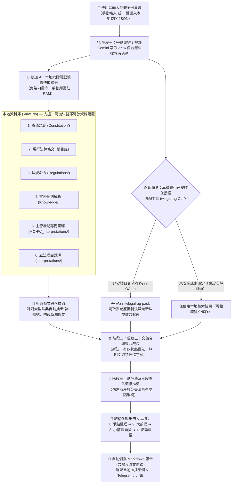

# ⚖️ 台灣法學三段論推演工作台 (`tw-legal-syllogism-workbench`)

一套專為**台灣歐陸法系（大陸法系）實務與法學研究**設計的開源本地端 AI 輔助推演工作台。

本專案整合 **法務部開放資料一鍵本地化腳本**、**兩階段法學爭點關鍵字提煉**、**本地六階層法規記憶體快取檢索（In-Memory RAG）**、**選配外部雲端裁判檢索 CLI 串接**、**嚴格兩岸／英美法系術語隔離網**，以及支援手機密碼管理員秒登的 **Gradio 網頁介面**，協助使用者在自有電腦環境下產出結構嚴謹的「法學三段論法」分析初稿。

> **⚠️ 免責聲明（Legal Disclaimer）**
> 本軟體及其生成之所有內容僅供**法學研究、教育展示與技術交流參考**，不構成任何形式之正式法律意見、訴訟策略或律師代理行為。實務案件請務必查核司法院及全國法規資料庫之最新官方公報，並諮詢合格執業律師。

---

## 🗺️ 系統雙軌檢索與三段論推演架構圖

GitHub 可直接渲染以下 Mermaid 流程圖，清楚呈現**「本地六階層快取 RAG」**與**「選配外部 `twlegalrag` CLI」**如何並存協作：



---

## ✨ 核心特色

1. **開箱即用：內建「法務部全國法規開放資料」一鍵下載器 (`download_moj_laws.py`)**
   - 不必自己寫爬蟲或手動整理法條！依據《著作權法》第 9 條與政府資料開放授權條款，只需一行指令（或直接在網頁介面點擊同步按鈕），數秒內即可從法務部官方 API 下載全國現行憲法與法律（亦可選配法規命令），自動過濾已廢止舊法，並依位階拆分存入 `./law_db/`。

2. **嚴格的台灣法學三段論架構與術語隔離網**
   - 強制依循「爭點整理 ➔ 大前提（規範與實務見解） ➔ 小前提（事實涵攝） ➔ 結論與建議」四段式論理。
   - 自動排除英美法系不當預設，嚴禁出現「合同」、「知識產權」、「法人代表」等非台灣法制用語；查無明文時強制標註法理推論，杜絕瞎掰條號。

3. **智慧長法典條文擷取 ＋ 跨領域專屬知識庫擴充**
   - 內建條文級段落計分器，面對《民法》等上千條文的大型法典也能精準抽出命中爭點的具體條號，不會因字數上限被切頭去尾。
   - 支援自行放入特定領域主管機關函釋（如衛福部醫事函釋、勞動部函釋）JSON 檔，打造跨領域實務工作台。

4. **雙軌並存架構（本地私密知識庫 ＋ 選配外部 `twlegalrag` CLI）**
   - 單靠本地 `./law_db` 即可完整獨立運作。
   - 若環境中另行安裝了公開原始碼檢索工具 [`twlegalrag`](https://github.com/aa0101181514/tw-legal-rag)，系統會自動偵測並合併雲端歷審判決與最新法條。

5. **隱私優先與前端資安加固 (`auth_engine.py`)**
   - 自帶 Google Gemini API Key（BYOK），支援手機／電腦密碼管理員自動填入登入，並於登入瞬間自動抹除前端 HTML DOM 密碼殘留。

---

## 🚀 快速開始 (Quick Start)

### 1. 下載專案與安裝套件

```bash
git clone https://github.com/johnkklin/tw-legal-syllogism-workbench.git
cd tw-legal-syllogism-workbench
pip install -r requirements.txt
```

### 2. 設定環境變數與一鍵下載全國現行法律

```bash
cp .env.example .env

# 選用（推薦）：從法務部開放資料一鍵建置全國現行憲法與法律庫
python download_moj_laws.py
# 若想連同數千筆行政機關「法規命令」一併下載，可加上 --with-orders：
# python download_moj_laws.py --with-orders
```
*(註：即使跳過終端機指令，啟動網頁後亦可直接點擊介面上的「⬇️ 一鍵從法務部開放資料同步現行法規」按鈕完成建置！)*

### 3. 啟動網頁介面

```bash
python legal_inquiry.py
```

打開瀏覽器前往 `http://127.0.0.1:8085`，貼上你在 [Google AI Studio](https://aistudio.google.com/) 申請的 **Gemini API Key** 即可開始使用！（點擊介面上的 **「📂 一鍵匯入案例卷證資料」** 即可載入內建的急診緊急手術範例測試。）

---

## 📂 自建本地 JSON 函釋與卷證格式說明

除了透過 `download_moj_laws.py` 自動建立全國法規外，你也可以將自己整理的無個資主管機關函釋或實務筆記存成 `.json` 放入 `./law_db/` 對應子資料夾（如 `MOHW_Interpretations/`、`Knowledge/`）：

### 單篇函釋或實務筆記範例
```json
{
  "title": "衛署醫字第○○○○號函（示例格式）",
  "path": "衛生福利部 > 醫事司",
  "content": "關於醫療法第63條第1項但書所稱『情況緊急者』之認定標準..."
}
```

### 多條文法規範例
```json
{
  "title": "醫療法（節錄）",
  "articles": [
    {
      "article_no": "醫療法 第 63 條",
      "article_content": "醫療機構實施手術，應向病人或其法定代理人、配偶、親屬或關係人說明..."
    }
  ]
}
```

---

## 🌐 選配：串接外部 `twlegalrag` 雲端檢索 CLI

若希望在本地法規與自有函釋庫之外，同步檢索全國歷審裁判與函釋效力履歷，可自行安裝由黃思齊律師（法律偵探 Dr.Legal）釋出之 CLI 工具：

```bash
pip install twlegalrag
```

安裝後依照該專案官方說明完成本機登入授權（或於 `.env` 設定 `TWLEGALRAG_TLR_API_KEY`），本工作台在階段二檢索時便會自動將雲端結果納入大前提比對。

> **獨立專案聲明**：本專案（`tw-legal-syllogism-workbench`）為獨立開發之 MIT 開源應用程式介面與推演框架，與 Dr.Legal（法律偵探）及 `tw-legal-rag` 專案無隸屬、代理或官方背書關係；相關商標與雲端檢索服務條款均歸原權利人所有，使用者請自行遵守其服務條款。

---

## 📱 進階選配：手機遠端操作與生物辨識秒登指南（Cloudflare Tunnel）

本工具預設綁定 `127.0.0.1:8085` 僅限電腦本機存取，以避免區網明文側錄。若希望在外出時透過 **iOS / Android 手機瀏覽器**安全連回家裡電腦操作，並啟用「Face ID／指紋辨識自動秒登」，建議搭配 **Cloudflare Tunnel**（或 Tailscale）建立 HTTPS 加密通道。

> **為什麼需要透過 HTTPS 連線？**
> iOS Safari 與 Android Chrome 基於系統安全機制，通常僅在 `https://` 加密網址下才會觸發密碼管理員的生物辨識自動填入功能；使用 Cloudflare Tunnel 可免費取得 HTTPS 憑證，且無須在路由器開放 Port Forwarding。

### 步驟一：建立 Cloudflare Tunnel 加密通道

1. 於電腦安裝 [Cloudflare `cloudflared`](https://developers.cloudflare.com/cloudflare-one/connections/connect-networks/downloads/)。
2. 先照常啟動本系統（`python legal_inquiry.py`，確認監聽於 `127.0.0.1:8085`）。
3. 依使用習慣選擇以下任一種通道模式：
   * **快速測試（免註冊、免網域，每次重啟網址會變動）**：
     ```bash
     cloudflared tunnel --url [http://127.0.0.1:8085](http://127.0.0.1:8085)
     ```
     終端機將會產生一組臨時的 `https://xxxx.trycloudflare.com` 網址，手機開啟即可操作。
   * **長期使用（推薦：綁定固定子網域）**：
     透過 Cloudflare Zero Trust 後台建立 Named Tunnel 並將固定網址（例如 `https://legal.你的網域.com`）指向 `http://127.0.0.1:8085`，才能讓手機密碼管理員永久記住該網址的金鑰。

### 步驟二：將 Gemini API Key 存入密碼管理員

本系統登入模組（`auth_engine.py`）已內建標準登入表單結構與自動送出腳本，支援 **Apple「密碼」App（iOS / macOS Face ID、Touch ID）**、**Google 密碼管理工具 / Samsung Pass（Android 指紋、臉部辨識）**，以及 **1Password / Bitwarden** 等跨平台工具：

1. 在手機或瀏覽器的密碼管理員中，為你的遠端網址新增一筆登入項目：
   * **網站（Website）**：填入你的 Cloudflare `https://...` 固定網址。
   * **使用者名稱（Username）**：隨意填寫即可（例如 `gemini` 或 `legal`，系統已內建隱藏帳號欄供密碼管理員辨識）。
   * **密碼（Password）**：貼上你的 **39 碼 Google Gemini API Key**（或 53 碼自訂代理金鑰）。
2. 下次以手機打開網頁時，輕觸「Gemini API Key」輸入框並透過 **Face ID 或指紋辨識**帶入密碼；系統偵測到有效長度後會**自動觸發登入**，並於送出後 350 毫秒內主動抹除前端瀏覽器 DOM 中的金鑰殘留。

> **🛡️ 重要資安提醒（強烈建議）**
> 本系統登入頁雖採自帶金鑰（BYOK）設計，但若你的本地 `./law_db` 放有個人整理的專屬函釋或 `./law_db/案例事實` 存有敏感卷證，公開網址理論上仍可能被取得網址且自備 Gemini Key 的陌生人嘗試存取。
> **若欲開啟遠端連線，務必在 Cloudflare Zero Trust 後台為該網域啟用 `Cloudflare Access`（設定僅限自己的 Email OTP 或 Google 帳號登入白名單），或改用純內網加密的 `Tailscale` 連線，確保個人卷證絕不外洩。**

---

## 📜 開源授權 (License)

本專案程式碼採用 [MIT License](./LICENSE) 授權釋出；透過 `download_moj_laws.py` 下載之全國法規資料來源為中華民國法務部全國法規資料庫（依政府資料開放授權條款－第 1 版提供，且依《著作權法》第 9 條法規本文不受著作權限制）。
